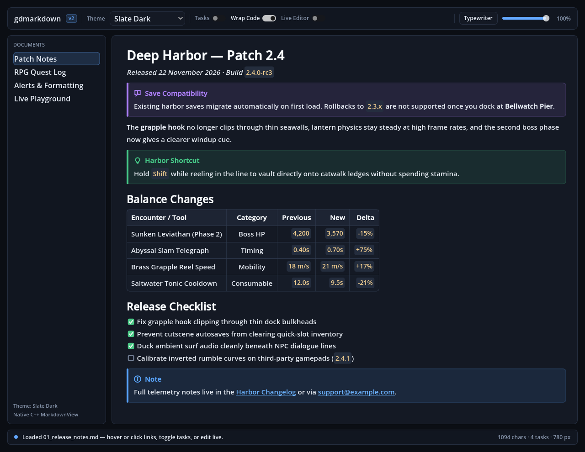
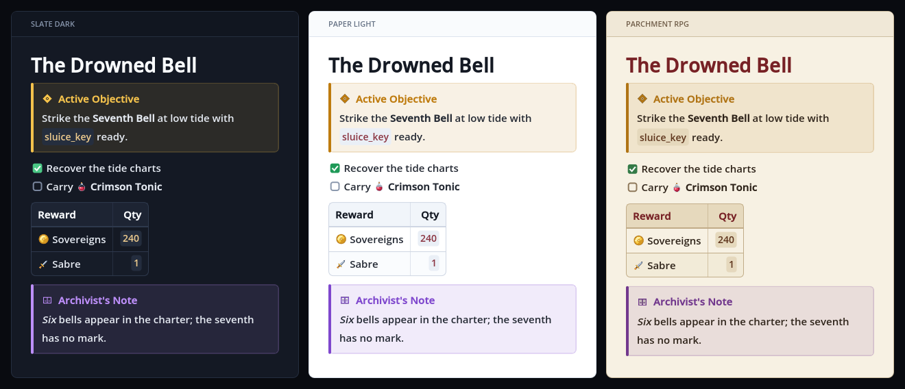
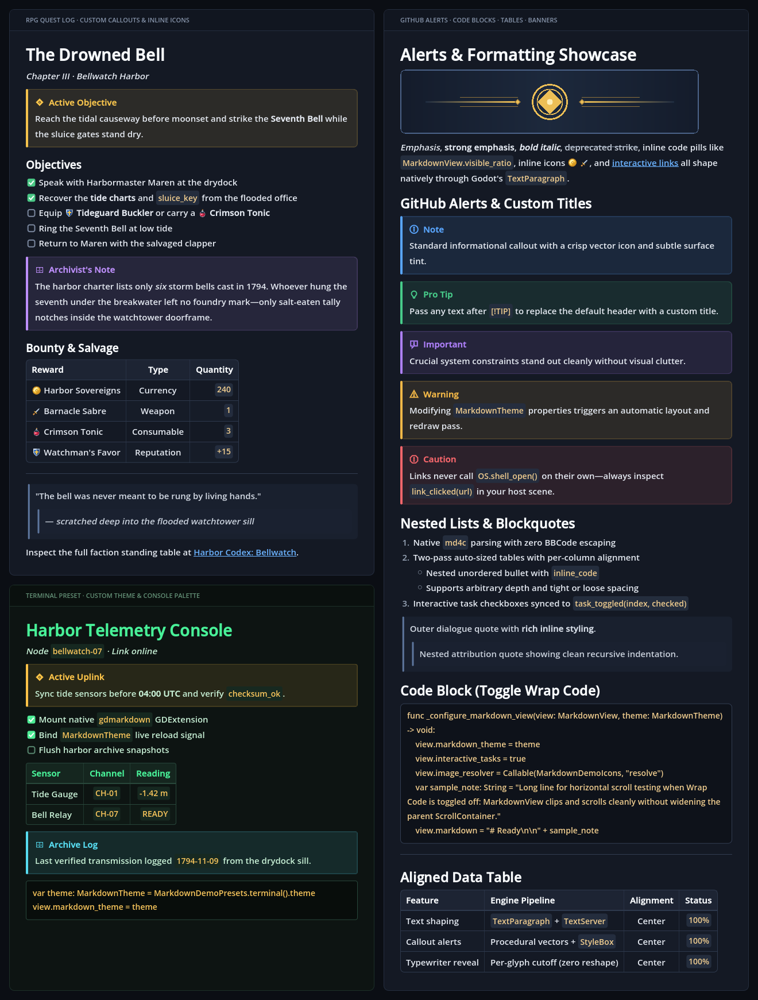

<div align="center">

# gdmarkdown

**Native C++ Markdown rendering for Godot 4, built directly on `Control`, `TextParagraph`, and `TextServer`.**

[-478cbf?logo=godotengine&logoColor=white)](https://godotengine.org)
[](LICENSE)
[](native)

[Install](#install) ·
[Quick start](#quick-start) ·
[Themes & callouts](#themes--callouts) ·
[API reference](#api-reference) ·
[What is supported](#what-is-supported) ·
[Building & testing](#building--testing) ·
[Architecture](docs/architecture.md) ·
[Releasing](docs/releasing.md)



</div>

---

`gdmarkdown` v2 is a native C++ GDExtension (`godot-cpp` + vendored `md4c`) for
Godot 4.6+ (verified on 4.7.2). Drop a `MarkdownView` into any container, assign
Markdown text, and it renders with a real block box model, two-pass auto-sized
tables, inline code pills, GitHub Alerts and custom game callouts, inline
images/icons, interactive task checkboxes, and zero-reshaping typewriter reveal
— without BBCode workarounds or network access.

```gdscript
var view: MarkdownView = MarkdownView.new()
view.markdown_theme = MarkdownTheme.create_dark()
view.interactive_tasks = true
view.markdown = """
# Patch Notes

> [!TIP] Pro Tip
> Press `Space` to trigger the **grapple hook** mid-air.

- [x] Reproduced the wall-clip bug
- [ ] Add regression coverage

See the [release notes](https://example.com/releases/2.0) for details.
"""
add_child(view)
```

## Why a native renderer

- **Real block layout, not BBCode translation.** Headings, blockquotes, callout
  cards, rounded code panels, auto-sized tables, and inline code pills are laid
  out directly onto Godot's `TextParagraph`, `TextServer`, and `StyleBox`
  pipeline, preserving native font shaping, HiDPI scaling, and container flow.
- **Responsive inside `ScrollContainer`.** `MarkdownView` reports a zero
  minimum width and dynamically re-wraps on resize so documents shrink and grow
  freely inside split panes and scroll views without locking horizontally.
- **Built for games.** Register custom callouts (`> [!QUEST]`, `> [!LORE]`),
  resolve inline item/currency icons via `image_resolver`, toggle interactive
  task checklists, and animate RPG dialogue with zero-reshaping `visible_ratio`
  / `visible_characters` typewriter reveal.
- **Zero network or shell side effects.** The addon never performs HTTP
  requests or calls `OS.shell_open`. Links emit signals and images resolve
  locally (`res://`) or through your own `image_resolver` callback.
- **One portable C++ codebase.** Ships prebuilt native binaries for macOS, iOS,
  Android, and Linux with no `SwiftGodot` or Java/Gradle dependencies.

## Install

### With `gpm` (recommended)

Install via [gpm](https://github.com/cafecito-games/godot-package-manager)
(`0.6.0` or newer):

```sh
gpm add --name gdmarkdown \
  --source github-release \
  --repo cafecito-games/gdmarkdown \
  --version <tag>
```

Enable **gdmarkdown** in *Project ▸ Project Settings ▸ Plugins*.

### Platform slices

Releases publish a `gpm-index.toml` alongside 8 independent platform slices, so
`gpm` downloads `core` plus only the native binaries your project targets:

| Slice | Contents |
| --- | --- |
| `core` | `plugin.cfg`, `plugin.gd`, `gdmarkdown.gdextension`, and `.uid` sidecars (no native binaries) |
| `ios` | `bin/ios/gdmarkdown.xcframework` — dynamic device `arm64` + simulator `arm64` framework (Godot 4.6+) |
| `macos.arm64` | `bin/macos_arm64/gdmarkdown.framework` — Apple Silicon macOS dynamic framework |
| `android.arm64` | `bin/android/libgdmarkdown.android.release.arm64.so` (`arm64-v8a`) |
| `android.arm32` | `bin/android/libgdmarkdown.android.release.arm32.so` (`armeabi-v7a`) |
| `android.x86_64` | `bin/android/libgdmarkdown.android.release.x86_64.so` (`x86_64`) |
| `linux.x86_64` | `bin/linux_x86_64/libgdmarkdown.so` (`x86_64`) |
| `linux.arm64` | `bin/linux_arm64/libgdmarkdown.so` (`arm64`) |

### Manual / vendored install

From a local checkout after building the native targets you need:

```sh
task vendor DEST=/path/to/your/godot-project
```

`task vendor` stages only the runtime `addons/gdmarkdown/` tree (never `native/`
build sources) and syncs it into the destination project.

## Quick start

```gdscript
@onready var quest_view: MarkdownView = %QuestView

func _ready() -> void:
	var theme: MarkdownTheme = MarkdownTheme.create_dark()
	theme.set_callout_style(
			"QUEST",
			MarkdownCalloutStyle.create(
					"Active Quest",
					Color(0.957, 0.761, 0.298),
					Color(0.957, 0.761, 0.298),
					preload("res://ui/icons/quest.png")
			)
	)

	quest_view.markdown_theme = theme
	quest_view.interactive_tasks = true
	quest_view.image_resolver = _resolve_inline_icon

	var clicked_err: int = quest_view.link_clicked.connect(_on_link_clicked)
	var hovered_err: int = quest_view.link_hovered.connect(_on_link_hovered)
	var task_err: int = quest_view.task_toggled.connect(_on_task_toggled)
	var layout_err: int = quest_view.layout_updated.connect(_on_layout_updated)
	assert(clicked_err == OK and hovered_err == OK and task_err == OK and layout_err == OK)

	quest_view.markdown = """
# The Drowned Bell

> [!QUEST] Main Objective
> Strike the **Seventh Bell** at low tide with `sluice_key` ready.

- [x] Recover the harbor charts
- [ ] Collect 240  Sovereigns

Read the [Harbor Charter](codex://harbor-charter).
"""

func _resolve_inline_icon(uri: String) -> Texture2D:
	if uri == "icon://gold":
		return preload("res://ui/icons/gold_coin.png")
	return null

func _on_link_clicked(url: String) -> void:
	if url.begins_with("https://"):
		OS.shell_open(url)

func _on_link_hovered(url: String) -> void:
	pass # Empty string when the pointer leaves a link.

func _on_task_toggled(task_index: int, checked: bool) -> void:
	pass # Persist quest objective state without re-parsing Markdown.

func _on_layout_updated() -> void:
	pass # Minimum height updated after content, theme, or width change.
```

### Typewriter reveal

Animate dialogue or codex entries using `visible_characters` or `visible_ratio`
without re-shaping paragraphs or shifting word wraps mid-word:

```gdscript
quest_view.visible_ratio = 0.0
var tween: Tween = create_tween()
tween.tween_property(quest_view, "visible_ratio", 1.0, 1.8)
```

## Themes & callouts

`MarkdownTheme` and `MarkdownCalloutStyle` are Inspector-editable `Resource`
classes. Mutating any property emits `changed` and automatically re-lays out
every attached `MarkdownView`.



Built-in presets `MarkdownTheme.create_dark()` and `MarkdownTheme.create_light()`
pre-seed all five GitHub Alert styles (`NOTE`, `TIP`, `IMPORTANT`, `WARNING`,
`CAUTION`) with procedural vector icons. Any custom directive such as
`> [!QUEST]` or `> [!LORE]` looks up its uppercased key in
`MarkdownTheme.callouts`, or synthesizes a clean title-cased fallback style
automatically.



Run `task demo` in a checkout to explore all four showcase presets (*Slate
Dark*, *Paper Light*, *Parchment RPG*, *Terminal*), toggle interactive tasks and
code wrapping, scrub typewriter reveal, and edit Markdown live.

## API reference

### `MarkdownView` (`Control`)

| Member | Type | Default | Description |
| --- | --- | --- | --- |
| `markdown` | `String` | `""` | Markdown source. Reassigning re-parses and resets runtime task states. |
| `markdown_theme` | `MarkdownTheme` | `null` | Styling resource. Falls back to an internal dark theme when unset. |
| `interactive_tasks` | `bool` | `false` | Allows clicking task checkboxes to toggle state and emit `task_toggled`. |
| `code_block_wrap` | `bool` | `true` | Wraps long code lines when `true`; enables horizontal scrolling with a scrollbar when `false`. |
| `visible_characters` | `int` | `-1` | Typewriter character limit (`-1` renders the full document). Synchronized with `visible_ratio`. |
| `visible_ratio` | `float` | `1.0` | Fraction of characters revealed (`0.0` to `1.0`). Synchronized with `visible_characters`. |
| `image_resolver` | `Callable` | `Callable()` | Optional `Callable(uri: String) -> Texture2D` checked before local `res://` loading. |

**Signals**

- `link_clicked(url: String)` — emitted on left-click over a link fragment.
- `link_hovered(url: String)` — emitted when entering a link, or with `""` on leave / `NOTIFICATION_MOUSE_EXIT`.
- `task_toggled(task_index: int, checked: bool)` — emitted when an interactive task checkbox is toggled by user input.
- `layout_updated()` — emitted after layout finishes rebuilding.

**Methods**

- `get_total_character_count() -> int` — total character count across laid-out paragraphs.
- `get_task_count() -> int` — number of task items parsed in the current document.
- `is_task_checked(task_index: int) -> bool` — current checked state of a 0-based task index (returns `false` if out of range).
- `set_task_checked(task_index: int, checked: bool) -> void` — updates a task checkbox visually without re-parsing Markdown.
- `get_plain_text() -> String` — extracted plain text with Markdown syntax stripped.
- `clear_image_cache() -> void` — drops cached `image_resolver` / `res://` textures and triggers a relayout.

### `MarkdownTheme` (`Resource`)

- **Factory presets:** `MarkdownTheme.create_dark()`, `MarkdownTheme.create_light()`
- **Fonts** *(inherit the `Control`'s default theme font when `null`)*:
  `regular_font`, `bold_font`, `italic_font`, `bold_italic_font`, `monospace_font`
- **Typography & `em` rhythm:**
  `base_font_size` (`16`), `code_font_scale` (`0.9`), `line_spacing` (`4.0`),
  `paragraph_spacing_em` (`0.75`), `heading_scales` (`[1.85, 1.5, 1.25, 1.1, 1.0, 0.9]`),
  `heading_top_spacing_em` (`1.1`), `heading_bottom_spacing_em` (`0.4`),
  `list_indent_em` (`1.5`), `list_item_spacing_em` (`0.3`), `blockquote_indent_em` (`1.0`)
- **Colors:**
  `text_color`, `heading_color`, `muted_color`, `link_color`, `link_hover_color`,
  `code_text_color`, `code_bg_color`, `inline_code_bg_color`, `strikethrough_color`,
  `rule_color`, `blockquote_accent_color`, `blockquote_bg_color`,
  `table_border_color`, `table_header_bg_color`, `table_alt_row_bg_color`,
  `task_checked_color`, `task_unchecked_color`
- **Optional `StyleBox` overrides** *(clean procedural rounded surfaces drawn when `null`)*:
  `code_block_style`, `inline_code_style`, `blockquote_style`, `table_style`, `table_header_style`
- **Metrics:**
  `inline_code_padding_horizontal` (`5.0`), `inline_code_padding_vertical` (`1.5`),
  `code_block_padding` (`12.0`), `blockquote_padding` (`10.0`), `blockquote_accent_width` (`3.0`),
  `callout_padding` (`12.0`), `callout_accent_width` (`4.0`), `callout_icon_size` (`16.0`),
  `table_cell_padding_horizontal` (`10.0`), `table_cell_padding_vertical` (`7.0`),
  `rule_thickness` (`1.0`), `corner_radius` (`6.0`), `max_image_height` (`420.0`),
  `inline_image_scale` (`1.15`)
- **Callout registry:**
  `callouts: Dictionary`, `set_callout_style(kind, style)`, `get_callout_style(kind)`, `get_heading_scale(level)`

### `MarkdownCalloutStyle` (`Resource`)

- **Properties:** `title`, `accent_color`, `title_color` *(falls back to `accent_color` when alpha is `0`)*, `icon` *(procedural vector icon drawn when `null`)*, `panel_style` *(tinted rounded panel with left accent bar drawn when `null`)*
- **Methods:** `MarkdownCalloutStyle.create(title, accent_color, title_color = Color(0, 0, 0, 0), icon = null, panel_style = null)`, `resolve_title_color() -> Color`

## What is supported

CommonMark + GitHub Flavored Markdown parsed by vendored `md4c` v0.6.0:

| Feature | Support |
| --- | --- |
| **Headings** | ATX (`#`–`######`) and setext (`===` / `---`) |
| **Inline formatting** | emphasis, strong, bold+italic, strikethrough (`~~text~~`), rounded inline code pills |
| **Links** | inline, reference, shortcut, angle and permissive autolinks, hover highlight & click signals |
| **Lists** | ordered (custom start index), unordered, nested, tight/loose, interactive GFM task checklists |
| **Blockquotes & callouts** | nested blockquotes, GitHub Alerts (`NOTE`, `TIP`, `IMPORTANT`, `WARNING`, `CAUTION`), custom titles (`> [!TIP] Pro Tip`), custom kinds (`> [!QUEST]`, `> [!LORE]`) |
| **Code blocks** | fenced (`` ``` `` / `~~~`) and indented, optional wrapping or clipped horizontal scroll |
| **Tables** | two-pass auto-sized GFM pipe tables with left/center/right alignment and narrow-container clamping |
| **Images** | inline icons scaled to text height and standalone block banners via `image_resolver` or `res://`, with alt-text fallback |
| **Breaks & escapes** | thematic breaks (`---`), hard/soft line breaks, `<br>` / `<br/>`, backslash escapes, HTML entities |

### Deliberate non-goals

- **No syntax highlighting** inside code blocks.
- **No LaTeX / math** or **animated GIF / APNG** decoding.
- **No arbitrary raw HTML/CSS layout** — `<br>` / `<br/>` become hard line breaks; all other raw HTML tags and blocks are safely omitted.
- **No Web / WASM target** and **no network I/O or `OS.shell_open`**.

## Building & testing

Requires [Task](https://taskfile.dev/), [SCons](https://scons.org/), a C++17
toolchain (Xcode for macOS/iOS, Android NDK for Android, GCC/Clang for Linux),
[gdkit](https://github.com/cafecito-games/gdkit) `0.11.0+`,
[gpm](https://github.com/cafecito-games/godot-package-manager) `0.6.0+`, and
Godot `4.6+` (pinned to `4.7.2` in CI).

```sh
# Install gdtest runner
task install

# Build native GDExtension binaries
task macos               # addons/gdmarkdown/bin/macos_arm64/gdmarkdown.framework
task ios                 # addons/gdmarkdown/bin/ios/gdmarkdown.xcframework (device + sim)
task android             # arm64, arm32, and x86_64 Android .so libraries
task linux               # linux_x86_64 / linux_arm64 .so libraries

# Test and verify
task test:native         # fast headless C++ unit tests (parser, callouts, table sizing)
task test:extension-load # throwaway Godot project load probe
task test:gdscript       # full gdtest integration suite
task lint                # gdkit format, lint, license, and uid checks
task verify:package      # cut and verify all 8 gpm slices + reproducibility

# Showcase, benchmarks, and screenshots
task demo                        # open the interactive showcase
./addons/gdtest/gdtest bench     # run parse and layout benchmarks
task screenshots                 # regenerate docs/images/*.png (needs GPU context)
```

See [docs/architecture.md](docs/architecture.md) for the native C++ pipeline and
[docs/releasing.md](docs/releasing.md) for the automated release workflow.

## License

MIT. See [LICENSE](LICENSE).

Every GDScript file carries an SPDX header managed by `gdkit license` and
verified in CI:

```gdscript
# gdkit:license:begin
# Copyright (c) 2026 Cafecito Games LLC
# SPDX-License-Identifier: MIT
# gdkit:license:end
```
