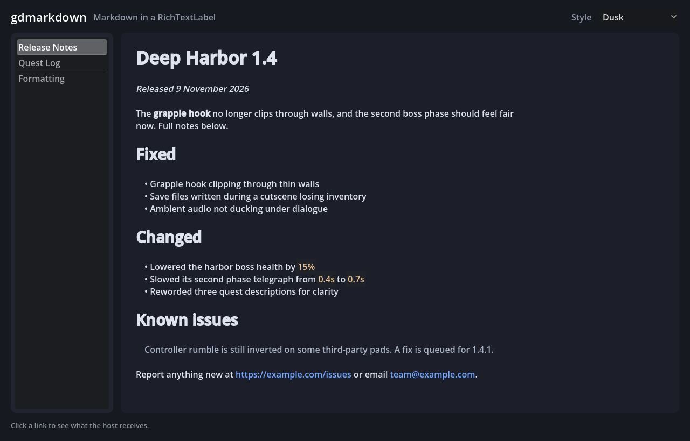
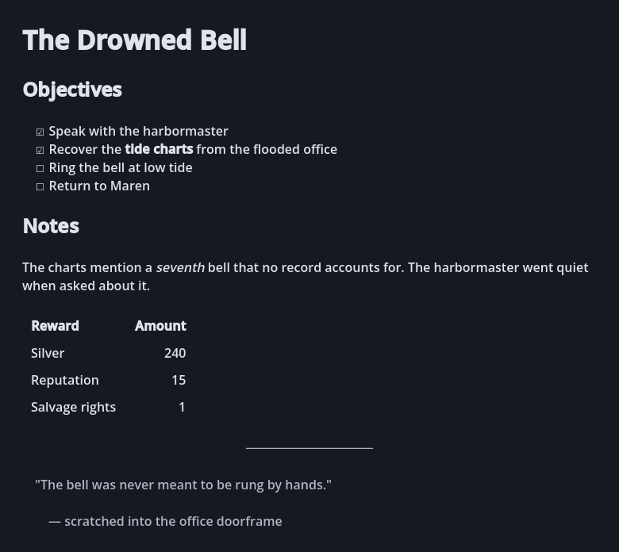
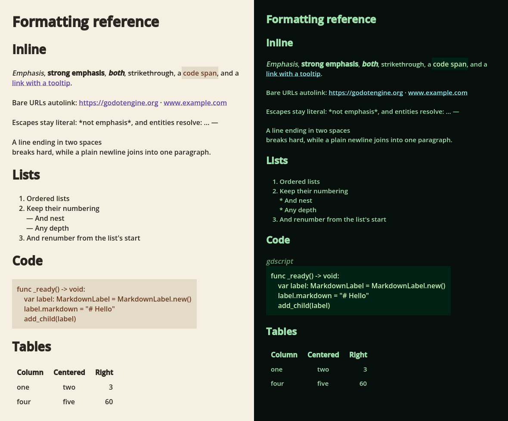

<div align="center">

# gdmarkdown

**Markdown rendering for Godot 4, straight into a `RichTextLabel`.**

[](https://godotengine.org)
[](LICENSE)
[](addons/gdmarkdown)

[Install](#install) ·
[Quick start](#quick-start) ·
[Styling](#styling) ·
[What is supported](#what-is-supported) ·
[Architecture](docs/architecture.md) ·
[Releasing](docs/releasing.md)



</div>

---

Drop a `MarkdownLabel` into a scene, assign Markdown to it, and it renders. No
build step, no native code, no runtime dependencies, nothing to configure. The
addon is pure GDScript and every public symbol is statically typed.

```gdscript
var label: MarkdownLabel = MarkdownLabel.new()
label.markdown = """
# Patch notes

Fixed the **grapple hook** clipping through walls.

- [x] Reproduced the bug
- [ ] Write a regression test

See the [issue](https://example.com/issues/42) for details.
"""
add_child(label)
```

## Why

`RichTextLabel` already knows how to lay out rich text — it just speaks BBCode,
which nobody wants to write by hand and no tool outside Godot produces. Your
quest text, patch notes, tutorials, item descriptions and design docs are
already Markdown. This addon is the translation layer between them, and nothing
else:

- **It is a `RichTextLabel`.** Every property you know still works —
  `fit_content`, `scroll_active`, `selection_enabled`, themes, shaders.
- **It never touches the network or the shell.** No HTTP client, no
  `OS.shell_open` on rendered content. Clicking a link emits a signal and your
  game decides.
- **It is a library, not a framework.** One node, one static facade, one style
  resource. Use the facade alone if you already own your label.

## Install

With [gpm](https://github.com/cafecito-games/godot-package-manager):

```sh
gpm add --name gdmarkdown \
  --source github-release \
  --repo cafecito-games/gdmarkdown \
  --version <tag>
```

Or copy `addons/gdmarkdown/` into your project. Either way, enable
**gdmarkdown** in *Project ▸ Project Settings ▸ Plugins*.

The addon is pure GDScript, so it publishes a single `core` slice and installs
the same files on every platform, mobile and web included.

## Quick start

### The node

```gdscript
@onready var notes: MarkdownLabel = $Notes

func _ready() -> void:
	notes.markdown = FileAccess.get_file_as_string("res://content/patch_notes.md")
	notes.link_clicked.connect(_on_link_clicked)

func _on_link_clicked(target: String) -> void:
	if target.begins_with("https://"):
		OS.shell_open(target)
```

| Member | Meaning |
| --- | --- |
| `markdown: String` | The Markdown source. Setting it re-renders. |
| `markdown_style: MarkdownStyle` | Visual settings. Empty means defaults. |
| `link_clicked(target: String)` | Emitted when a link is clicked. |
| `get_document() -> MarkdownDocument` | The parsed tree, for an outline or a search index. |

Conversion runs in the editor too, so the inspector shows the rendered result
as you type.

### Without the node

```gdscript
label.bbcode_enabled = true
label.text = Markdown.to_bbcode(source, my_style)
```

`Markdown.parse(source)` returns the document tree instead — useful for
building a table of contents, extracting every link, or walking headings.

## What it renders

Lists, tables, task lists, code blocks and nested quotes, all from plain
Markdown:



## Styling

`MarkdownStyle` is a `Resource`: inspector-editable, saveable as a `.tres`, and
shareable between labels. Changing any property re-renders every label using
it. Nothing in the addon assumes a dark theme.



| Property | Default | Meaning |
| --- | --- | --- |
| `heading_font_sizes` | `[32, 28, 24, 20, 18, 16]` | Font size per heading level |
| `heading_bold` | `true` | Whether headings render bold |
| `code_background_color` | dark slate | Background of code spans and blocks |
| `code_text_color` | warm sand | Text color of code spans and blocks |
| `solid_code_background` | `true` | Draw code blocks as a padded rectangle |
| `code_block_padding` | `10` | Padding inside a solid code block |
| `show_code_language` | `false` | Print a fence's info string above it |
| `quote_color` | muted grey | Block quotes and thematic breaks |
| `link_color` | blue | Link color, when `color_links` is on |
| `color_links` | `true` | Off inherits the label's own theme |
| `unordered_bullet` | `•` | Bullet in front of unordered items |
| `task_unchecked_glyph` | `☐` | Unchecked task list marker |
| `task_checked_glyph` | `☑` | Checked task list marker |
| `thematic_break_text` | `──────────` | Text drawn for `---` |
| `table_cell_padding` | `(10, 4)` | Padding inside a table cell |
| `render_tables` | `true` | Off renders rows as plain lines, which reflows better |
| `preserve_soft_breaks` | `false` | Keep single newlines as line breaks |
| `image_width` | `0` | Scale images to this width; 0 keeps natural size |

Run `godot --path .` in a checkout to open the demo above and switch between
the three presets live.

## What is supported

Everything a `RichTextLabel` can express, from CommonMark and the GitHub
Flavored Markdown extensions:

| | |
| --- | --- |
| **Headings** | ATX (`# Title`) and setext (`Title` over `===`) |
| **Inline** | emphasis, strong, `***both***`, strikethrough, code spans |
| **Code blocks** | fenced with ``` or `~~~`, info strings, and indented |
| **Quotes** | nested to any depth, containing any other block |
| **Lists** | ordered, unordered, nested, task; tight or loose; any start number |
| **Links** | inline, reference, collapsed, shortcut, angle and bare-URL autolinks |
| **Images** | from `res://` and `user://`, optionally scaled |
| **Tables** | GFM pipe tables with per-column alignment |
| **Text** | thematic breaks, hard line breaks, backslash escapes, HTML entities |

### Deliberate limits

Four things this addon will not do, and why:

- **Images are local only.** A `res://` or `user://` path the project can load
  becomes an `[img]`. Anything else, a remote URL included, renders as its
  alternate text linked to the URL. Shipping an HTTP client inside a text
  renderer would make every rendered document a potential network request.
- **Raw HTML renders as literal text.** A `RichTextLabel` cannot lay out HTML,
  and passing tags through would mean inventing a mapping per element.
- **Emphasis resolution is forward-searching, not CommonMark's delimiter
  stack.** Every ordinary nesting resolves identically. Pathological
  overlapping runs such as `*foo**bar*baz**` render as literal text rather than
  being guessed at.
- **No syntax highlighting.** A fence's info string is parsed and available on
  the tree; `show_code_language` prints it above the block. Highlighting a
  dozen languages is a different project.

## Performance

A full conversion of a 40-line document, on an M3 Pro, median of 30 samples:

| Stage | Median |
| --- | --- |
| Block parsing | 0.45 ms |
| Inline expansion | 0.42 ms |
| BBCode emission | 0.18 ms |
| **Full conversion** | **1.10 ms** |

Conversion happens once per assignment to `markdown`, not per frame, so this is
a load-time cost rather than a frame-time one. Run `task bench` to measure on
your own hardware.

## Developing

Requires [gdkit](https://github.com/cafecito-games/gdkit) 0.11.0 or newer for
linting, formatting and license headers,
[gpm](https://github.com/cafecito-games/godot-package-manager) 0.6.0 or newer
to install the test runner, and Godot 4.7.

```sh
gpm install          # installs the gdtest runner into addons/gdtest
task lint            # gdkit format, lint, license and uid checks
task test            # 169 cases across six suites
task bench           # timings for each pipeline stage
task demo            # open the interactive demo
task screenshots     # regenerate the images in this README
task verify:package  # cut and verify a release archive without publishing
```

Releases are cut by the **Release** workflow: pick `patch`, `minor`, or
`major`, and the version is derived from the latest tag, injected into
`plugin.cfg` and the changelog, verified, committed, tagged and published. See
[docs/releasing.md](docs/releasing.md). Write changelog entries under
`## [Unreleased]` as you go — that section becomes the release body, and a
release with it empty is refused.

Every GDScript warning Godot 4.7 offers is enabled as an **error** in
`project.godot`, including `untyped_declaration`, `inferred_declaration` and
the four `unsafe_*` warnings, and `gdkit lint` additionally requires return,
argument, variable, collection, loop-variable and signal-argument types. There
is no `:=` and no implicit `Variant` anywhere in the addon, by construction
rather than by review.

`docs/architecture.md` explains the pipeline and the trade-offs behind it.

## License

MIT. See [LICENSE](LICENSE).

Every GDScript file carries an SPDX header that `gdkit license` manages and CI
verifies, so the licensing travels with any file someone copies out of the
addon:

```gdscript
# gdkit:license:begin
# Copyright (c) 2026 Cafecito Games LLC
# SPDX-License-Identifier: MIT
# gdkit:license:end
```
